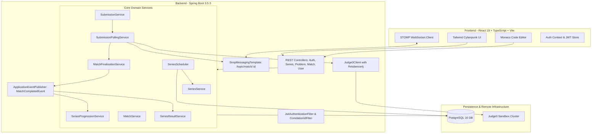

# ARCHITECTURE.md — AlgoClash Architectural Blueprint

This document specifies the technical architecture, design patterns, subsystem decomposition, and implementation mechanics of the **AlgoClash** platform.

---

## 1. System Overview



---

## 2. Components & Modules

### 2.1 Backend Modules (`com.algoclash`)

| Module | Primary Classes | Responsibility | Inputs / Outputs | Dependencies |
|---|---|---|---|---|
| **`auth`** | `AuthController`, `AuthService`, `JwtService`, `JwtAuthenticationFilter`, `CustomUserDetailsService` | User registration, password hashing, JWT generation/parsing, per-request security context population. | In: `RegisterRequest`, `AuthRequest`<br>Out: `AuthResponse(token)` | `user` module, Spring Security, JJWT |
| **`common`** | `CorrelationIdFilter`, `SecurityUtils`, `DevSeedController` | Correlation ID generation via SLF4J MDC, authentication principal extraction helpers, development seeding utilities. | In: HTTP headers (`X-Request-Id`)<br>Out: Populated MDC & response header | Servlet API, Spring Security |
| **`config`** | `SecurityConfig`, `WebSocketConfig`, `CorsConfig`, `AdminSeederConfig`, `OpenApiConfig`, `GlobalExceptionHandler` | Spring Security filter chain configuration, STOMP endpoints, CORS policies, default admin creation (`admin/admin123`), OpenAPI Swagger. | In: Spring Lifecycle<br>Out: Initialized Beans & Security chain | Spring Boot, Spring Security |
| **`problem`** | `ProblemController`, `ProblemService`, `ProblemRepository`, `Problem`, `ProblemDifficulty` | Problem CRUD, test cases storage, difficulty ratings, time/memory limit management. | In: `CreateProblemRequest`<br>Out: `ProblemResponse` | `user` module (author), JPA |
| **`series`** | `SeriesController`, `SeriesService`, `SeriesScheduler`, `SeriesProgressionService`, `SeriesResultService`, `BracketStrategyRegistry` | Tournament creation, participant joining, bracket generation, round advancement, Elo rating updates, cron scheduling. | In: `CreateSeriesRequest`<br>Out: `SeriesDetailResponse`, `SeriesSummaryResponse` | `user`, `problem`, `match` modules |
| **`match`** | `MatchController`, `MatchService`, `MatchRepository`, `Match`, `MatchState` | 1v1 match retrieval, access control, state management (`PENDING`, `ONGOING`, `COMPLETED`, `CANCELLED`). | In: Match ID, Authenticated User<br>Out: `MatchResponse` | `user`, `problem`, `series`, `submission` |
| **`submission`** | `SubmissionController`, `SubmissionService`, `SubmissionPollingService`, `MatchFinalizationService`, `Judge0Client` | Submission recording, asynchronous judging, Judge0 communication, pessimistic match finalization, STOMP notification. | In: `CreateSubmissionRequest`<br>Out: `SubmissionResponse`, STOMP updates | `match`, `user`, Judge0 API, WebSocket |
| **`user`** | `UserController`, `UserService`, `UserRepository`, `User`, `UserRole` | User identity persistence, public user directory, profile statistics, 10 recent matches. | In: Username / User ID<br>Out: `UserProfileResponse` | `match` module (for history) |

---

## 3. Target Folder Structure

```text
algo-clash/
├── docker-compose.yml                      # PostgreSQL 16 + Judge0 stack
├── backend/
│   ├── pom.xml                             # Spring Boot 3.5.3, Java 17, Lombok 1.18.38
│   ├── src/main/resources/
│   │   └── application.properties          # DB, JWT, CORS, Judge0, Resilience4j config
│   └── src/main/java/com/algoclash/
│       ├── BackendApplication.java         # Main Spring Boot entry point (@EnableScheduling, @EnableAsync)
│       ├── auth/
│       │   ├── AuthController.java
│       │   ├── AuthService.java
│       │   ├── CustomUserDetails.java
│       │   ├── CustomUserDetailsService.java
│       │   ├── JwtAuthenticationFilter.java
│       │   ├── JwtService.java
│       │   └── dto/                        # AuthRequest, AuthResponse, RegisterRequest
│       ├── common/
│       │   ├── DevSeedController.java
│       │   ├── SecurityUtils.java
│       │   └── filter/CorrelationIdFilter.java
│       ├── config/
│       │   ├── AdminSeederConfig.java       # Seeds admin / admin123 on first launch
│       │   ├── AppConfig.java              # RestTemplate bean
│       │   ├── CorsConfig.java
│       │   ├── GlobalExceptionHandler.java
│       │   ├── OpenApiConfig.java
│       │   ├── SecurityConfig.java         # SecurityFilterChain & RBAC
│       │   └── WebSocketConfig.java        # STOMP /ws-algoclash broker
│       ├── match/
│       │   ├── Match.java
│       │   ├── MatchController.java
│       │   ├── MatchRepository.java        # Pessimistic write lock query
│       │   ├── MatchService.java
│       │   ├── MatchState.java
│       │   └── dto/MatchResponse.java
│       ├── problem/
│       │   ├── Problem.java
│       │   ├── ProblemController.java
│       │   ├── ProblemDifficulty.java
│       │   ├── ProblemRepository.java
│       │   ├── ProblemService.java
│       │   └── dto/                        # CreateProblemRequest, ProblemResponse
│       ├── series/
│       │   ├── Series.java
│       │   ├── SeriesController.java
│       │   ├── SeriesProgressionService.java
│       │   ├── SeriesRepository.java
│       │   ├── SeriesResultService.java
│       │   ├── SeriesRoundConfig.java
│       │   ├── SeriesRoundConfigRepository.java
│       │   ├── SeriesScheduler.java        # Cron: starts due series & times out stale matches
│       │   ├── SeriesService.java
│       │   ├── SeriesStatus.java
│       │   ├── bracket/                    # BracketStrategy, BracketStrategyRegistry, SingleEliminationStrategy
│       │   ├── dto/                        # SeriesDetailResponse, SeriesSummaryResponse, etc.
│       │   └── event/MatchCompletedEvent.java
│       ├── submission/
│       │   ├── MatchFinalizationService.java
│       │   ├── Submission.java
│       │   ├── SubmissionController.java
│       │   ├── SubmissionLanguage.java
│       │   ├── SubmissionRepository.java
│       │   ├── SubmissionService.java
│       │   ├── SubmissionVerdict.java
│       │   ├── dto/                        # CreateSubmissionRequest, SubmissionResponse, SubmissionUpdateMessage
│       │   └── judge/                      # Judge0Client, Judge0Response, SubmissionPollingService, TestCase
│       └── user/
│           ├── User.java
│           ├── UserController.java
│           ├── UserRepository.java
│           ├── UserRole.java
│           ├── UserService.java
│           └── dto/                        # RecentMatchDto, UserProfileResponse
├── frontend/
│   ├── package.json                        # React 19, TypeScript, Vite, Tailwind, Monaco, STOMP
│   ├── vite.config.ts
│   ├── tailwind.config.js
│   ├── .env                                # VITE_API_BASE_URL, VITE_WS_BASE_URL
│   ├── index.html
│   └── src/
│       ├── main.tsx
│       ├── App.tsx                         # BrowserRouter routes & guards
│       ├── index.css                       # Tailwind directives
│       ├── api/                            # client.ts (Axios), matches.ts, problems.ts, series.ts, users.ts
│       ├── auth/                           # AuthContext.tsx
│       ├── components/                     # Layout.tsx, DifficultyBadge.tsx, SeriesCountdown.tsx
│       ├── pages/                          # LandingPage, LoginPage, RegisterPage, DashboardPage, SeriesListPage,
│       │                                   # SeriesDetailPage, MatchPage, ProfilePage, AdminProblemsPage, AdminCreateSeriesPage
│       └── routes/                         # ProtectedRoute.tsx, AdminRoute.tsx
└── judge0/
    ├── docker-compose.yml
    └── judge0.conf
```

---

## 4. Communication & Architecture Patterns

### 4.1 Layered Controller → Service → Repository
- Controllers handle HTTP parsing, DTO binding (`@Valid`), and RBAC authentication guards (`@PreAuthorize`).
- Services coordinate business transactions (`@Transactional`), enforce business invariants, and fire internal domain events.
- Repositories interface with PostgreSQL via Spring Data JPA. DTOs insulate internal database schemas from the external REST contract.

### 4.2 State Machine Pattern
The lifecycle of both `Series` and `Match` is governed by explicit state enums:
- `SeriesStatus`: `CREATED` → `REGISTRATION_OPEN` → `REGISTRATION_CLOSED` → `ONGOING` → `COMPLETED`.
- `MatchState`: `PENDING` → `ONGOING` → `COMPLETED` (or `CANCELLED`).
Illegal actions (e.g. submitting code for a `COMPLETED` match, or viewing a `PENDING` match) are intercepted by state guard checks.

### 4.3 Strategy Pattern for Brackets
Tournament bracket generation is decoupled using:
```java
public interface BracketStrategy {
    boolean supports(int size);
    List<Match> generateFirstRound(Series series, List<User> participants, Problem problem);
    List<Match> generateNextRound(Series series, List<User> winners, int roundNumber, Problem problem);
}
```
`BracketStrategyRegistry` dynamically locates the strategy supporting the tournament size (currently any power of 2 using `SingleEliminationBracketStrategy`). Swiss or Round-Robin strategies can be registered without modifying `SeriesService`.

### 4.4 Event-Driven Domain Pub/Sub
- When a match concludes with an `ACCEPTED` submission, `MatchFinalizationService` fires a synchronous Spring `MatchCompletedEvent(matchId, winnerId, loserId, seriesId)`.
- Multiple decoupled services listen to this event in the same transaction:
  - `SeriesResultService`: Updates Elo rating (+10 / -5) and win/loss statistics.
  - `SeriesProgressionService`: Evaluates round completion and advances the bracket to the next round.

### 4.5 STOMP over WebSocket Push Architecture
- STOMP simple broker enabled with `/topic` destination prefix.
- Clients subscribe to `/topic/match/{matchId}` using SockJS.
- `SubmissionPollingService` broadcasts `SubmissionUpdateMessage` when judging completes, allowing instant UI updates on both competitors' browsers.

### 4.6 Concurrency & Pessimistic Locking
To prevent race conditions where both duelists submit accepted solutions at the same instant:
- `MatchFinalizationService.finalize(matchId, winnerId)` runs under `Propagation.REQUIRES_NEW`.
- Queries the match using `MatchRepository.findByIdForUpdate(matchId)`, acquiring a Postgres row-level `SELECT ... FOR UPDATE` lock.
- Only the first transaction to lock the row sets the winner and transitions state to `COMPLETED`; subsequent transactions detect the `COMPLETED` state and safely exit.

### 4.7 Resilience4j Circuit Breaker & Retry
Calls to the remote Judge0 HTTP endpoint (`POST /submissions`) are wrapped with:
- `@Retry(name = "judge0")`: 3 attempts with 500ms backoff on `RestClientException`.
- `@CircuitBreaker(name = "judge0", fallbackMethod = "fallbackSubmit")`: Opens if 80% of calls fail in a sliding window of 5 calls. During open state (30s), fallback returns `null`, causing the submission to immediately settle as `INTERNAL_ERROR` rather than stalling application threads.

---

## 5. Startup & Bootstrapping Sequence

1. **Database Initialization**: Hibernate connects to PostgreSQL (`jdbc:postgresql://localhost:5432/algoclash`), applying `ddl-auto=update` to verify/create schemas for `users`, `problems`, `series`, `series_participants`, `series_round_config`, `matches`, and `submissions`.
2. **Admin User Seeding**: `AdminSeederConfig.java` executes on startup (`CommandLineRunner`). If `userRepository.existsByUsername("admin")` is false, it persists an account with username `admin`, email `admin@algoclash.dev`, BCrypt-hashed password for `admin123`, `UserRole.ADMIN`, and rating `1500`.
3. **Correlation ID & Security Filters**: Registers `CorrelationIdFilter` (Order 1) to inject `X-Request-Id` and `JwtAuthenticationFilter` before `UsernamePasswordAuthenticationFilter`.
4. **WebSocket Endpoint**: Registers STOMP endpoint `/ws-algoclash` with SockJS fallback and CORS origins.
5. **Scheduled Jobs**: Enables background timers:
   - `startDueSeries()`: Runs every 10 seconds.
   - `cancelTimedOutMatches()`: Runs every 60 seconds.

---

## 6. Detailed Data Flow Diagrams

### Flow: Code Submission & Asynchronous Evaluation

```
[User Browser]           [SubmissionController]        [SubmissionService]      [SubmissionPollingService]       [Judge0Client]       [MatchFinalizationService]      [STOMP WebSocket]
     │                             │                           │                            │                          │                         │                            │
     │── POST /matches/1/subs ────►│                           │                            │                          │                         │                            │
     │                             │── createSubmission() ────►│                            │                          │                         │                            │
     │                             │                           │── Insert Submission(PEND) ─│                          │                         │                            │
     │                             │                           │── evaluateSubmission() ───►│ (Async thread)           │                         │                            │
     │◄── 200 OK (Submission) ────│                           │                            │                          │                         │                            │
     │                             │                           │                            │── submitAndWait() ──────►│                         │                            │
     │                             │                           │                            │                          │── POST to Judge0 ──────►│                            │
     │                             │                           │                            │                          │◄── Status: 3 (Accepted) │                            │
     │                             │                           │                            │◄── Judge0Response ───────│                         │                            │
     │                             │                           │                            │                                                    │                            │
     │                             │                           │                            │── finalize(matchId, winnerId) ────────────────────►│                            │
     │                             │                           │                            │                                                    │── SELECT FOR UPDATE        │
     │                             │                           │                            │                                                    │── Set Winner & COMPLETED   │
     │                             │                           │                            │                                                    │── Publish CompletedEvent   │
     │                             │                           │                            │── Broadcast /topic/match/1 ────────────────────────────────────────────────────►│
     │◄────────────────────────────┴───────────────────────────┴────────────────────────────┴─────────────────────────────────────────────────────────────────────────────────│
     │                             (Live verdict badge displays "ACCEPTED" and winner tag appears on UI)                                                                      │
```

---

## 7. Tricky Implementation Gotchas & Edge Cases

1. **Lombok with Java 21+ / 25**:
   - `pom.xml` must use Lombok `1.18.38` or newer. Versions `<= 1.18.34` fail compilation on modern JDKs due to `com.sun.tools.javac.code.TypeTag` internal changes.
2. **Infinite JSON Recursion**:
   - In `Submission.java`, the `@ManyToOne` fields for `match` and `user` **must** be annotated with `@JsonIgnore`. Failure to do this will cause Jackson stack overflow crashes when serializing submissions.
3. **Series Round Config Unique Constraint**:
   - `series_round_config` requires `@UniqueConstraint(columnNames = {"series_id", "round_number"})` to prevent duplicate problem assignments for the same round.
4. **Timezone Offset in Series Kickoff**:
   - In `AdminCreateSeriesPage.tsx`, input datetime-local values must be converted using `.toISOString()` to preserve correct UTC times across different client timezones.
5. **WebSocket Base URL Derivation**:
   - `MatchPage.tsx` derives WebSocket host via:
     `import.meta.env.VITE_WS_BASE_URL ?? import.meta.env.VITE_API_BASE_URL?.replace('/api', '')`
     Ensuring consistent connection in both dev and production.
