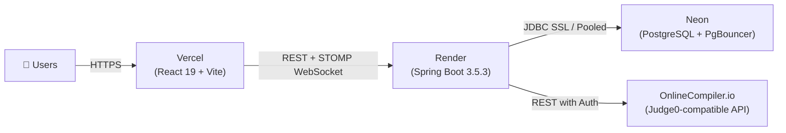

# 🚀 AlgoClash — Complete Production Deployment Guide

> **Stack**: Vercel (Frontend SPA) · Render (Backend Spring Boot Docker) · Neon (Serverless PostgreSQL + PgBouncer) · OnlineCompiler.io (Free Judge0-compatible Code Runner)



---

## 1️⃣ Neon Database Setup (Serverless PostgreSQL)

1. Go to **[neon.tech](https://neon.tech)** and sign in / create an account.
2. Click **Create Project**:
   - **Name**: `algoclash`
   - **Region**: Pick the region closest to your Render server (e.g., `AWS us-east-2` Ohio or `us-east-1`).
3. **Turn ON Connection Pooling**:
   - In the Neon dashboard under **Connection Details**, locate the **Connection pooling** toggle and switch it **ON**.
   - Notice that the host changes to include `-pooler` (e.g. `ep-xyz-pooler.us-east-2.aws.neon.tech`).
4. Note your credentials:
   - **Host**: `ep-xxxx-pooler.<region>.aws.neon.tech`
   - **Database**: `neondb`
   - **User**: `neondb_owner`
   - **Password**: `your_neon_password`
5. **Construct your Spring Boot JDBC URL**:
   ```
   jdbc:postgresql://ep-xxxx-pooler.<region>.aws.neon.tech/neondb?sslmode=require
   ```
   > [!IMPORTANT]
   > - The `-pooler` hostname uses Neon's transaction-mode PgBouncer, preventing connection slot exhaustion.
   > - The `?sslmode=require` query parameter is **mandatory** for Neon. Without it, connection attempts will be rejected.

---

## 2️⃣ OnlineCompiler.io Setup (Free Code Execution)

Since RapidAPI now requires a paid plan, AlgoClash integrates natively with **OnlineCompiler.io**, offering **100,000 free code executions/month**:

1. Go to **[onlinecompiler.io](https://onlinecompiler.io)** and create a free account.
2. In your dashboard, copy your **API Key** (Auth Token).
3. In AlgoClash, you will configure:
   - `JUDGE0_URL` = `https://api.onlinecompiler.io/api/judge0`
   - `JUDGE0_API_KEY` = `<your_api_key>`
4. `Judge0Client` automatically passes `X-Auth-Token` and `Authorization: Bearer <key>` to all submission calls.

---

## 3️⃣ Render Backend Deployment

### Option A: Docker Deployment (Recommended)

1. Go to **[render.com](https://render.com)** → **New +** → **Web Service**.
2. Connect your GitHub repository (`shivanshmishra123/AlgoClash`).
3. Configure service:
   - **Name**: `algoclash-backend`
   - **Root Directory**: `backend`
   - **Runtime**: `Docker`
   - **Dockerfile Path**: `./Dockerfile`
   - **Instance Type**: `Free`
4. Set the **Environment Variables** in the Render Dashboard:

| Key | Example Value | Description |
|---|---|---|
| `PORT` | `8080` | Service listening port |
| `SPRING_DATASOURCE_URL` | `jdbc:postgresql://ep-xxx-pooler.us-east-2.aws.neon.tech/neondb?sslmode=require` | Pooled Neon JDBC URL |
| `SPRING_DATASOURCE_USERNAME` | `neondb_owner` | Neon database username |
| `SPRING_DATASOURCE_PASSWORD` | `your_neon_password` | Neon database password |
| `JWT_SECRET` | *(64-character hex string)* | Generate with `openssl rand -hex 32` |
| `JWT_EXPIRATION_HOURS` | `24` | Token lifetime |
| `APP_CORS_ALLOWED_ORIGIN` | `https://your-algoclash.vercel.app` | Vercel production frontend URL |
| `JUDGE0_URL` | `https://api.onlinecompiler.io/api/judge0` | Code execution endpoint |
| `JUDGE0_API_KEY` | *(your OnlineCompiler.io API key)* | Free tier auth token |

5. Click **Create Web Service**. Render will build the multi-stage Docker image and launch the service.
6. Verify deployment by visiting:
   ```
   https://algoclash-backend.onrender.com/api/health
   ```
   It should return `{"status":"UP","service":"algoclash-backend",...}`.

> [!TIP]
> **Free Tier Cold Starts**: Render's free tier spins down after 15 minutes of inactivity. The first request after sleep takes ~30–50s. You can ping `https://<your-backend>.onrender.com/api/health` via a free uptime monitor (e.g., UptimeRobot, Cron-job.org) every 10 minutes to keep it warm.

---

## 4️⃣ Vercel Frontend Deployment

1. Go to **[vercel.com](https://vercel.com)** → **Add New...** → **Project**.
2. Import your GitHub repository (`shivanshmishra123/AlgoClash`).
3. Configure project settings:
   - **Framework Preset**: `Vite`
   - **Root Directory**: Click *Edit* and select `frontend`
   - **Build Command**: `npm run build`
   - **Output Directory**: `dist`
4. Expand **Environment Variables** and add:

| Key | Value |
|---|---|
| `VITE_API_BASE_URL` | `https://algoclash-backend.onrender.com/api` |
| `VITE_WS_BASE_URL` | `https://algoclash-backend.onrender.com` |

*(Replace `algoclash-backend.onrender.com` with your actual Render service domain).*

5. Click **Deploy**. Vercel will install dependencies, build the React SPA, and assign an HTTPS URL (e.g., `https://algoclash.vercel.app`).

> [!NOTE]
> Single Page App (SPA) client-side routing is already preconfigured via [`frontend/vercel.json`](file:///c:/Users/13shi/OneDrive/Desktop/reverse-engineering/frontend/vercel.json). Refreshing on routes like `/match/12` will automatically resolve without 404s.

---

## 5️⃣ Post-Deployment Verification & Seeding

Once both services are deployed:

1. **Update Backend CORS**:
   In the Render dashboard, ensure `APP_CORS_ALLOWED_ORIGIN` matches your final Vercel URL (e.g., `https://algoclash.vercel.app`).

2. **Default Admin Account**:
   On the very first startup against Neon, the backend automatically seeds a default admin user:
   - **Username**: `admin`
   - **Password**: `admin123`
   - **Role**: `ADMIN`

3. **Verification Checklist**:
   - [ ] Navigate to `https://<your-frontend>.vercel.app/login`
   - [ ] Log in with `admin` / `admin123`
   - [ ] Open developer tools (F12) → Console to confirm no CORS or WebSocket handshake errors
   - [ ] Check `/api/health` on Render to verify uptime
   - [ ] Test 1v1 matchmaking or problem submission with Java / C++ code
   - [ ] Confirm code execution receives verdict from OnlineCompiler.io
